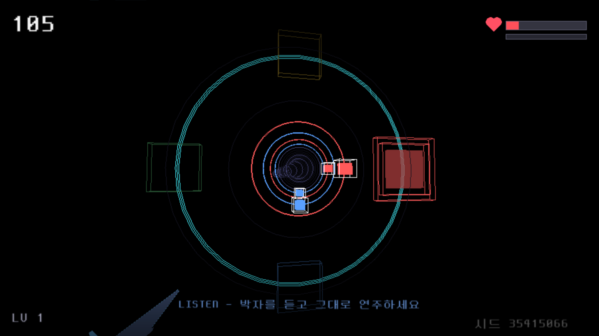

# Rhythm Tunnel



[게임 플레이 영상 (유튜브)](https://youtu.be/nhpDWR3qPBQ)

---

### 프로젝트 소개

3D 터널을 배경으로 한 **콜&리스폰스 리듬 게임**.  
게임이 한 마디를 연주하면, 같은 리듬이 몬스터가 되어 정면에서 날아옵니다.  
링이 노란 게이트에 겹치는 순간 방향을 누르세요.

1.44MB GAME_DEV 공모전 출품작입니다.  
플로피 디스크 한 장에 들어가야 한다는 조건 하나로 설계 전체가 결정되었으며, **에셋 파일이 하나도 없습니다.**  
효과음은 전부 런타임 합성이고, 폰트는 실제로 화면에 그리는 글자만 골라 소스에 구워 넣습니다.  
최종 빌드는 exe 하나, 1,195,008 바이트입니다.

### 개발 기간

약 5일 (2026.09.02 ~ 2026.09.06)

- **v1.0** — 9월 2일 ~ 4일 (3일)
  - 공모전 제출 버전
- **v1.1** — 9월 5일 ~ 6일 (2일)
  - 제출 이후 밸런스 조정, 게임패드 지원, 편의 기능 보완

### 개발 환경

| 항목 | 내용 |
|---|---|
| 언어 | C |
| IDE | Visual Studio 2022 |
| 컴파일러 | MSVC x64 · `/MT` `/O1(MinSpace)` `/utf-8` · 전체 프로그램 최적화 |
| 링커 | `/SUBSYSTEM:WINDOWS` · 진입점 `mainCRTStartup` |
| 라이브러리 | raylib 6.0 (정적 링크) |
| 폰트 | 네오둥근모 → `Tools/fontbake.c`로 아틀라스를 소스에 임베드 |
| 대상 | Windows 10 이상 x64 |

### 다운로드 링크

[itch.io 상점 페이지](https://verebell.itch.io/rhythm-tunnel)

---

### 저장소

```
LowByteGame/     Visual Studio 솔루션. main.c 단일 파일 7,231줄 + 생성된 폰트 헤더
Tools/           폰트 베이크, 문구 감사, 카드 텍스트 폭 검사, 세이브 테스트
Documents/       NOTES.md — 설계 판단과 그 근거를 남긴 개발 기록 (4,700줄+)
```

빌드 산출물과 배포본은 커밋하지 않습니다. 실행 파일은 **Releases**에 있습니다.

### 빌드

Visual Studio 2022 / x64 Release.

raylib 6.0을 직접 빌드한 뒤, `LowByteGame.vcxproj`의 `AdditionalIncludeDirectories`와 `AdditionalLibraryDirectories`를 본인 경로로 고쳐야 합니다.  
현재는 제 로컬 경로가 들어 있습니다.

`neodgm16.h` / `neodgm32.h`는 `Tools/fontbake.c`가 만든 생성물입니다.  
커밋되어 있으므로 빌드에는 그대로 쓰면 되지만, 다시 만들려면 원본 `neodgm.ttf`가 필요합니다.
